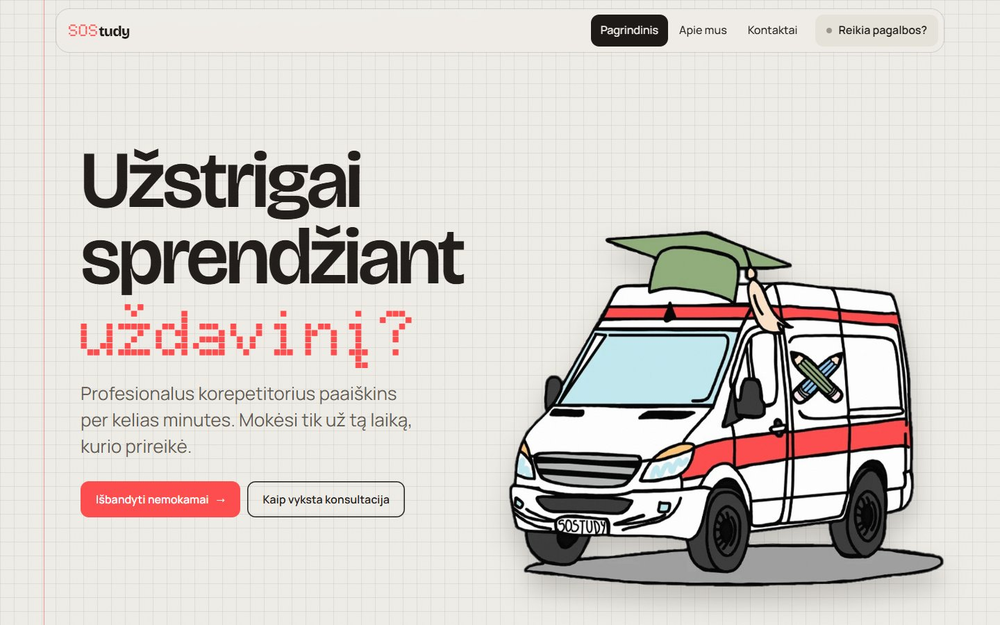

# SOStudy

Website for SOStudy, an on-demand math tutoring service in Lithuania. A student who is stuck on a problem sends it in (with a photo if they like) and a tutor explains it within minutes.

**Live:** [sostudy.lt](https://sostudy.lt) (in Lithuanian) · **Availability widget with sample data:** [sostudy.lt/reikia-pagalbos/?demo](https://sostudy.lt/reikia-pagalbos/?demo)




<p>
  
  
</p>

## Features

- **Live tutor availability.** Each tutor's Google Calendar is read by a small Apps Script that publishes only free time windows, never event details. The help page merges them into a free/busy status, a 7-day grid of 30-minute dots and up to six suggested times.
- **Help request form.** Drag and drop, paste or pick a photo of the problem. Large photos are resized in the browser before upload. `send.php` emails the request with the photo attached and stores nothing. If it is unavailable, the form falls back to FormSubmit.
- **Waiting game.** If the calendar check takes longer than a moment, a small canvas game appears. It gets harder as the score grows and the best score is kept in `localStorage`.
- **Scroll scenes.** Built with GSAP ScrollTrigger: a notebook where the solution writes itself, a swipeable card stack for the steps, team cards that flip.
- **LinkedIn feed.** A second Apps Script reads the company's public LinkedIn page every 6 hours. A saved copy in `assets/data/linkedin.json` is used when it is not reachable.
- **No build step.** Plain HTML, CSS and JavaScript with self-hosted fonts and scripts.

## How it works

```
Google Calendar ──► Apps Script, one per tutor ──► { free: [[start, end], ...] }
                                                          │
                       availability.js: merge windows, pick suggested times
                                                          │
                       help.js: status, week grid, time buttons, chosen time
                                                          │
Request form ──► send.php ──► email to tutors (photo attached)
                  └── fallback: FormSubmit
```

**Stack:** HTML, CSS, JavaScript, GSAP, PHP, Google Apps Script. Hosted on Hostinger (Apache).

## Possible improvements

- Unit tests for the availability logic (merging windows and picking slots in `availability.js` and `apps-script/Code.gs`).
- Confirm a chosen time automatically. Right now it is confirmed by email.

## Structure

```
index.html              Home
apie-mus/               About: story, team, articles, LinkedIn
reikia-pagalbos/        Help request form + live availability
kontaktai/              Contacts
privatumo-politika/     Privacy policy
naudojimosi-taisykles/  Terms of service
send.php                Mail handler (photo attached, nothing stored)
assets/js/config.js     Endpoints and links (edit this first)
apps-script/            Google Calendar availability service
apps-script/linkedin/   LinkedIn feed service
assets/data/            Saved copy of LinkedIn posts (fallback)
docs/                   Screenshots for this README
```

## Setup

1. **Form:** set the founders' emails in `send.php` (`$TO`). To use Formspree instead, set `formEndpoint` in `assets/js/config.js` to the Formspree URL.
2. **Availability:** follow `apps-script/README.md`, then put the `/exec` URLs into `assets/js/config.local.js` (copy `config.local.example.js`). That file is ignored by git, so upload it to Hostinger by hand once.
3. **LinkedIn posts:** follow `apps-script/linkedin/README.md` and paste the `/exec` URL into `linkedinFeed` in `assets/js/config.js`. New posts then appear automatically.
4. **Legal pages:** fill in the highlighted placeholders (company details, video platform, email provider, retention period).

Fonts and scripts are self-hosted, so the only third-party requests are the Google availability check, the LinkedIn feed and LinkedIn post images.

## Upload to Hostinger

Needs a Hostinger **web hosting** plan (not Website Builder) with sostudy.lt attached.

1. hPanel → **Security → SSL**: make sure SSL is active for sostudy.lt (the site redirects to https).
2. hPanel → **Files → File Manager** → open `public_html` and delete the old files there.
3. Upload these files and folders (or one zip of them, then right-click → Extract):
   `.htaccess`, `index.html`, `404.html`, `robots.txt`, `sitemap.xml`, `send.php`, `assets/` (including `assets/js/config.local.js`), `apie-mus/`, `kontaktai/`, `reikia-pagalbos/`, `privatumo-politika/`, `naudojimosi-taisykles/`.
   Do not upload `README.md`, `docs/`, `apps-script/` or anything starting with a dot other than `.htaccess`.
4. Send a test message with a photo from both forms. If `send.php` cannot send, the forms fall back to FormSubmit automatically.
5. Google Search Console → add sostudy.lt → submit `https://sostudy.lt/sitemap.xml`.

## Local preview

```
npx serve .
```

Add `?demo` or `?demo=busy` to the help page URL to see the availability widget with sample data.

## History

The git history starts on 5 October 2026, when the project moved here from an older local repository that was later lost.
