# SOStudy

Website for SOStudy, an on-demand maths tutoring service in Lithuania. A student who is stuck on a problem sends it in, with a photo if they like, and a tutor explains it within minutes.

**Live:** [sostudy.lt](https://sostudy.lt) (in Lithuanian) · **Availability widget with sample data:** [sostudy.lt/reikia-pagalbos/?demo](https://sostudy.lt/reikia-pagalbos/?demo)


## How it works

Tutors keep using their own Google Calendars. A small Apps Script per tutor turns each calendar into a list of free time windows, and the help page merges those into a live "is anyone free?" status. Requests go out by email, and nothing is stored on the server.

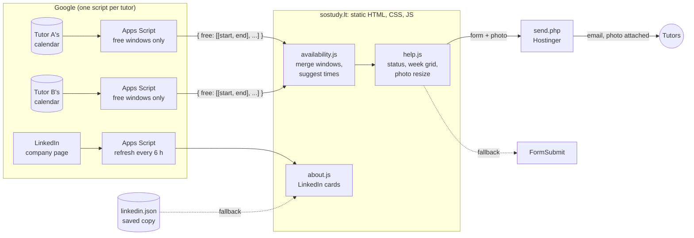

What happens when a student asks for help:

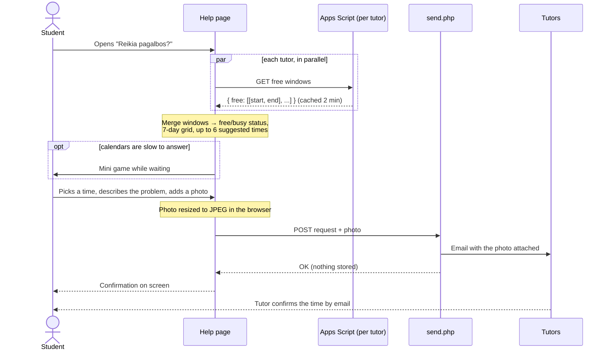

## Features

- **Live tutor availability.** Each tutor's Google Calendar is read by a small Apps Script that publishes only free time windows, never event details. The help page merges them into a free/busy status, a 7-day grid of 30-minute dots and up to six suggested times.
- **Help request form.** Drag and drop, paste or pick a photo of the problem. Large photos are resized in the browser before upload. `send.php` emails the request with the photo attached and stores nothing. If it's unavailable, the form falls back to FormSubmit.
- **Waiting game.** If the calendar check takes longer than a moment, a small canvas game appears. It gets harder as the score grows, and the best score is kept in `localStorage`.
- **Scroll scenes.** Built with GSAP ScrollTrigger: a notebook where the solution writes itself, a swipeable card stack for the steps, and team cards that flip.
- **LinkedIn feed.** A second Apps Script reads the company's public LinkedIn page every 6 hours. When that's unreachable, the site uses a saved copy in `assets/data/linkedin.json`.
- **No build step.** Plain HTML, CSS and JavaScript with self-hosted fonts and scripts.

**Stack:** HTML, CSS, JavaScript, GSAP, PHP, Google Apps Script. Hosted on Hostinger (Apache).

## Screenshots

### Home

| The solution writes itself as you scroll | Four steps as a swipeable card stack |
|---|---|
|  | 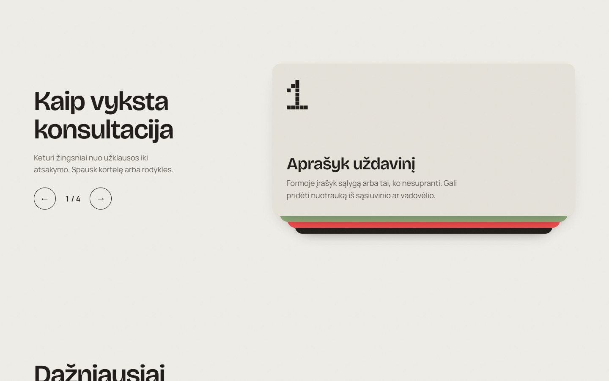 |

### Asking for help

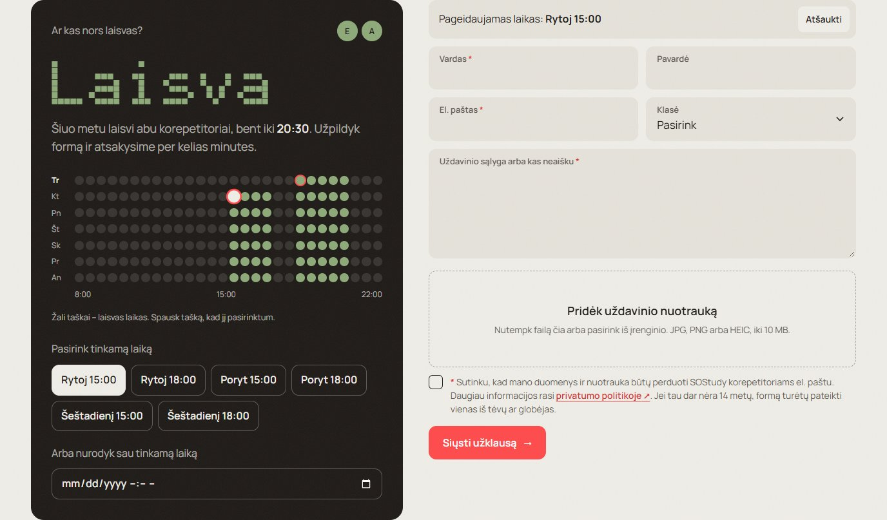

| Mini game while calendars load | Contacts |
|---|---|
| 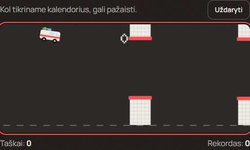 | 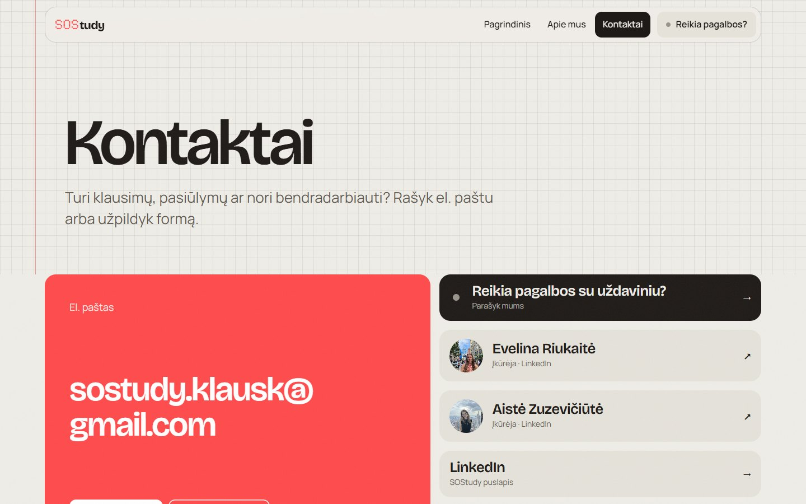 |

### About

| Timeline | LinkedIn feed |
|---|---|
| 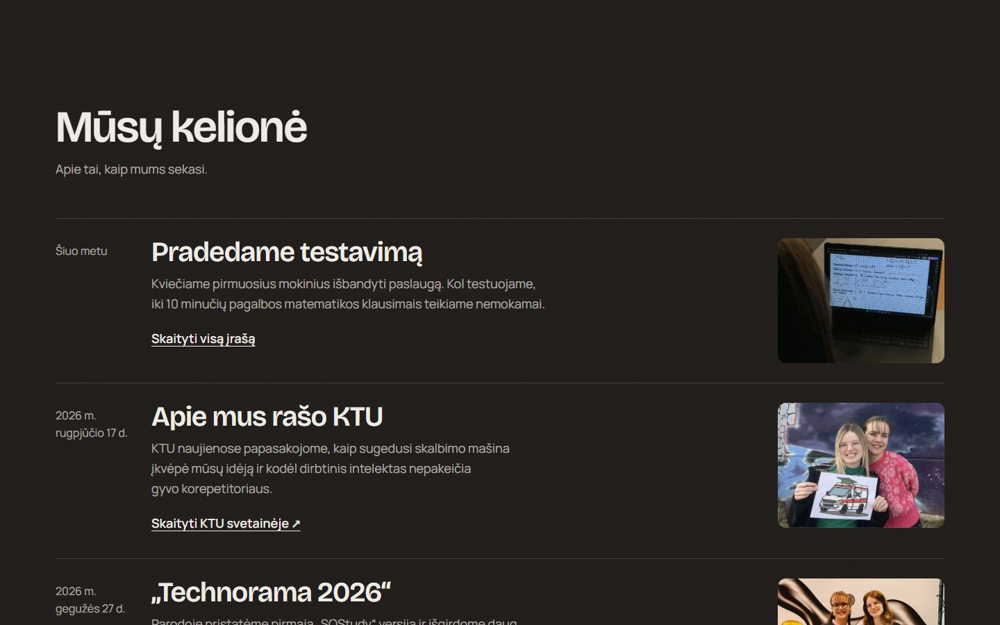 | 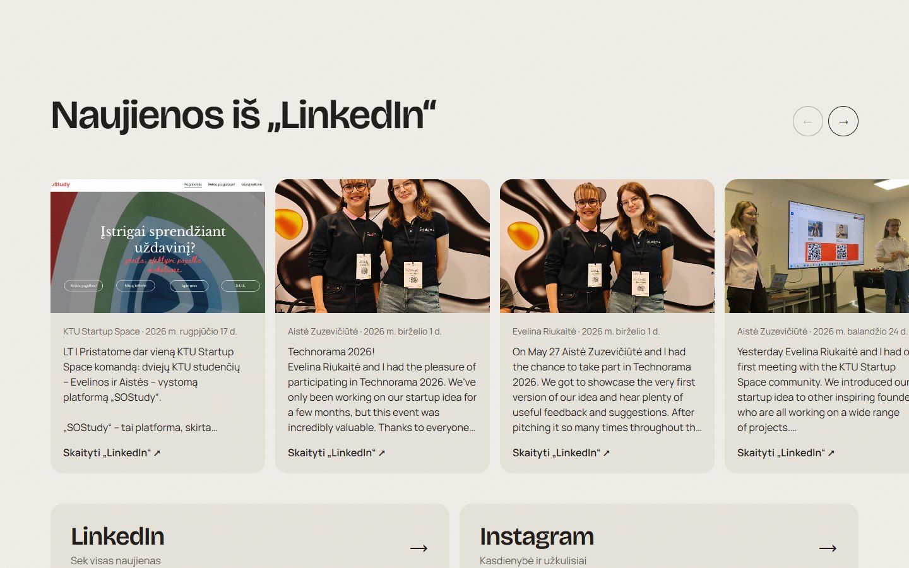 |

### On a phone

<p>
  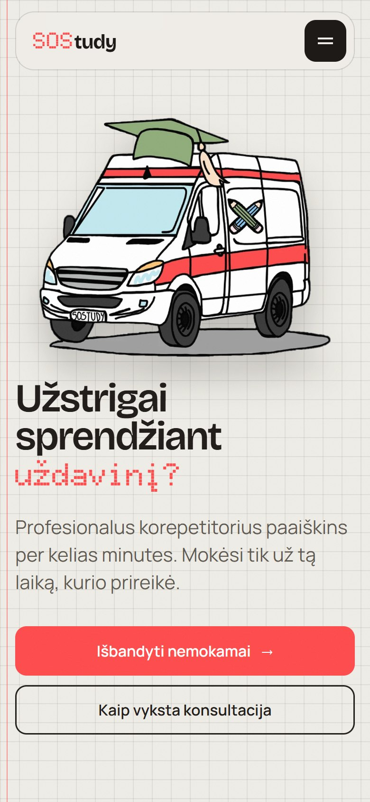
  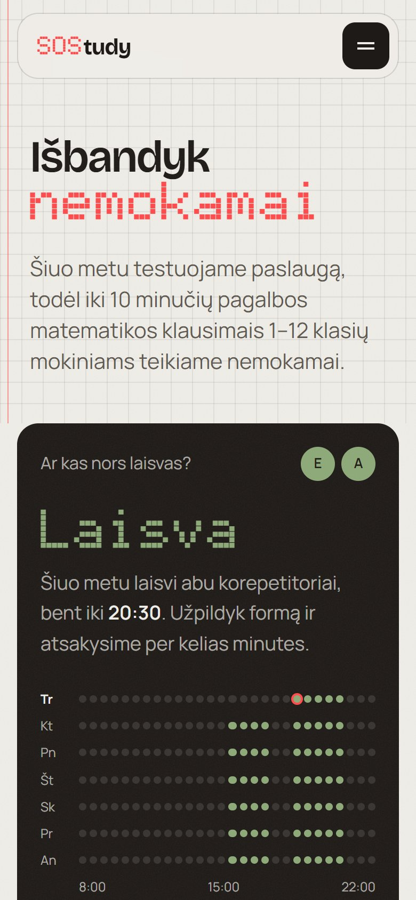
  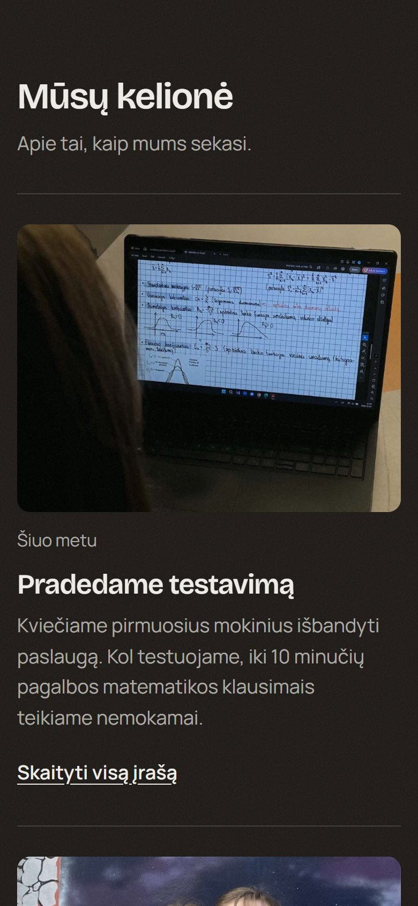
</p>

## Privacy

- Tutors' calendars never leave Google. The scripts publish free time windows only, with no titles, attendees or descriptions.
- `send.php` passes the request and photo straight to email and keeps no copy.
- Fonts and scripts are self-hosted. The only third-party requests are the availability check, the LinkedIn feed and LinkedIn post images.

## Structure

```
index.html              Home
apie-mus/               About: story, team, articles, LinkedIn
reikia-pagalbos/        Help request form + live availability
kontaktai/              Contacts
privatumo-politika/     Privacy policy
naudojimosi-taisykles/  Terms of service
send.php                Mail handler (photo attached, nothing stored)
assets/js/config.js     Endpoints and links (edit this first)
apps-script/            Google Calendar availability service
apps-script/linkedin/   LinkedIn feed service
assets/data/            Saved copy of LinkedIn posts (fallback)
docs/                   Screenshots for this README
```

## Setup

1. **Form:** set the founders' emails in `send.php` (`$TO`). To use Formspree instead, set `formEndpoint` in `assets/js/config.js` to the Formspree URL.
2. **Availability:** follow `apps-script/README.md`, then put the `/exec` URLs into `assets/js/config.local.js` (copy `config.local.example.js`). Git ignores that file, so upload it to Hostinger by hand once.
3. **LinkedIn posts:** follow `apps-script/linkedin/README.md` and paste the `/exec` URL into `linkedinFeed` in `assets/js/config.js`. New posts then appear automatically.
4. **Legal pages:** fill in the highlighted placeholders (company details, video platform, email provider, retention period).

## Possible improvements

- Unit tests for the availability logic (merging windows and picking slots in `availability.js` and `apps-script/Code.gs`).
- Confirm a chosen time automatically. Right now it's confirmed by email.
